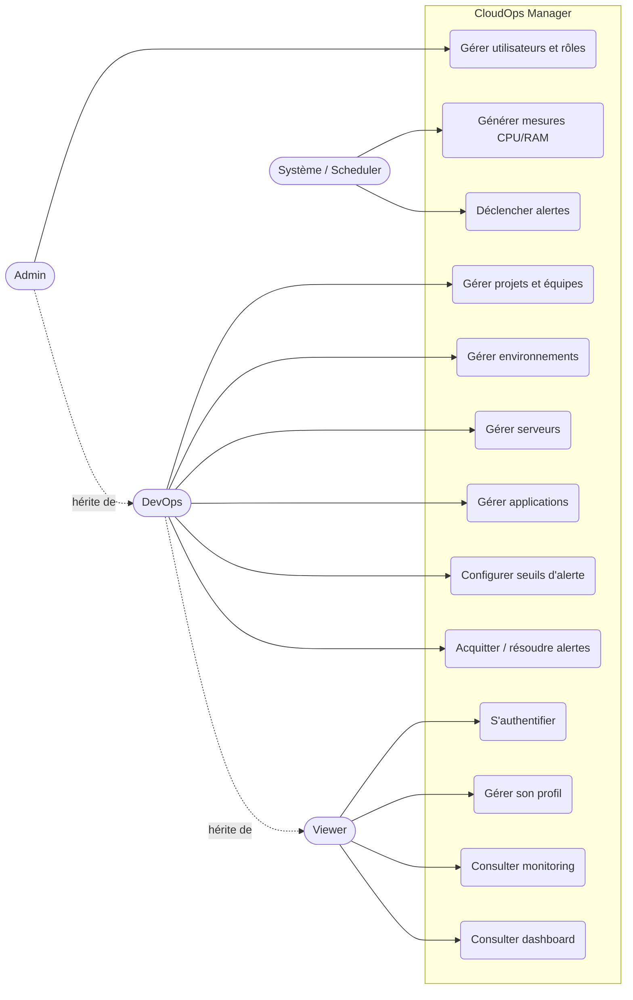
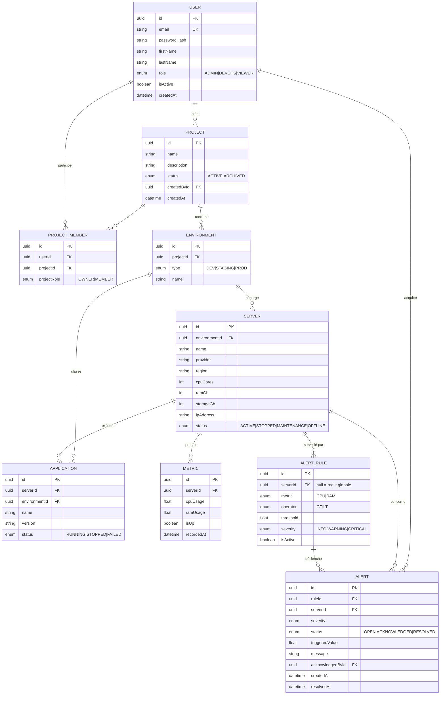
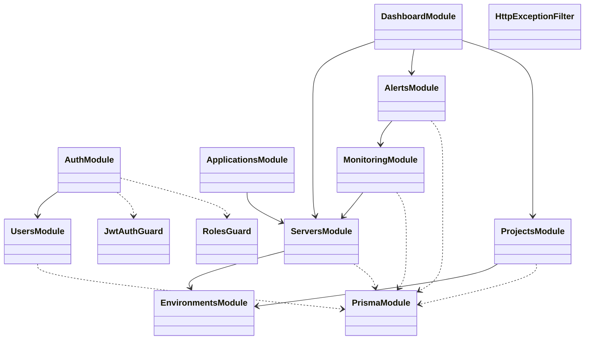
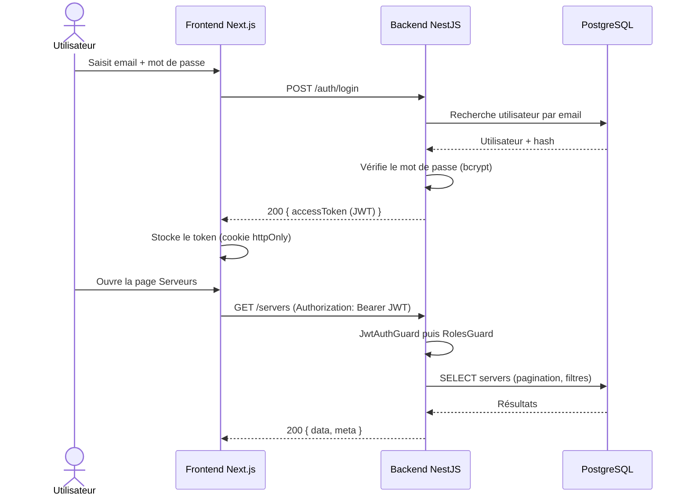
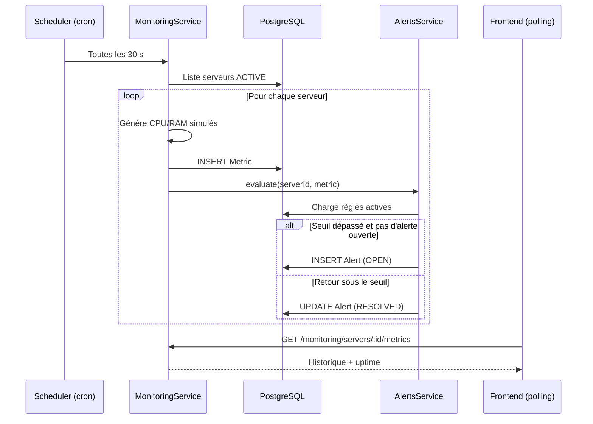
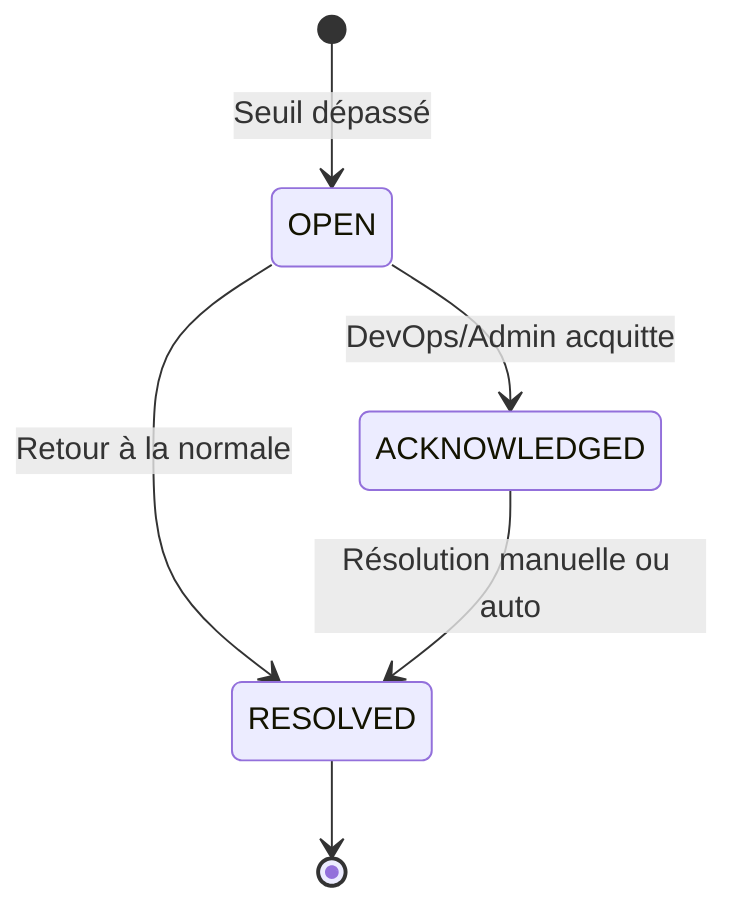

# 02 — Modélisation UML

> Les diagrammes sont en **Mermaid** : ils s'affichent directement sur GitHub. Pour le rapport, exportez-les en image avec https://mermaid.live.

## 1. Diagramme de cas d'utilisation

## 2. Modèle de données (diagramme entité-relation)

**9 entités** (≥ 8 exigées) : User, Project, ProjectMember, Environment, Server, Application, Metric, AlertRule, Alert.

## 3. Diagramme de classes (couche backend NestJS)

## 4. Diagramme de séquence — Authentification et accès protégé

## 5. Diagramme de séquence — Mesure simulée et déclenchement d'alerte

## 6. Diagramme d'états — Cycle de vie d'une alerte

